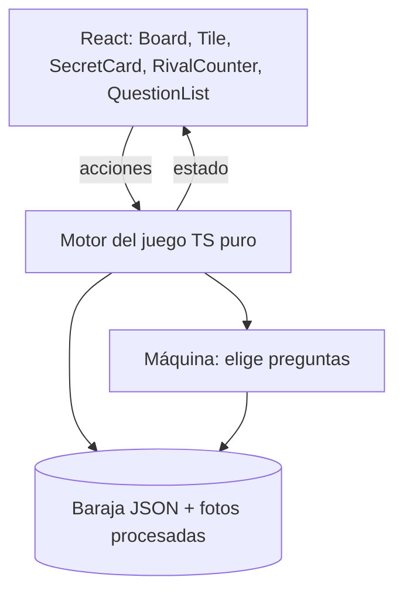
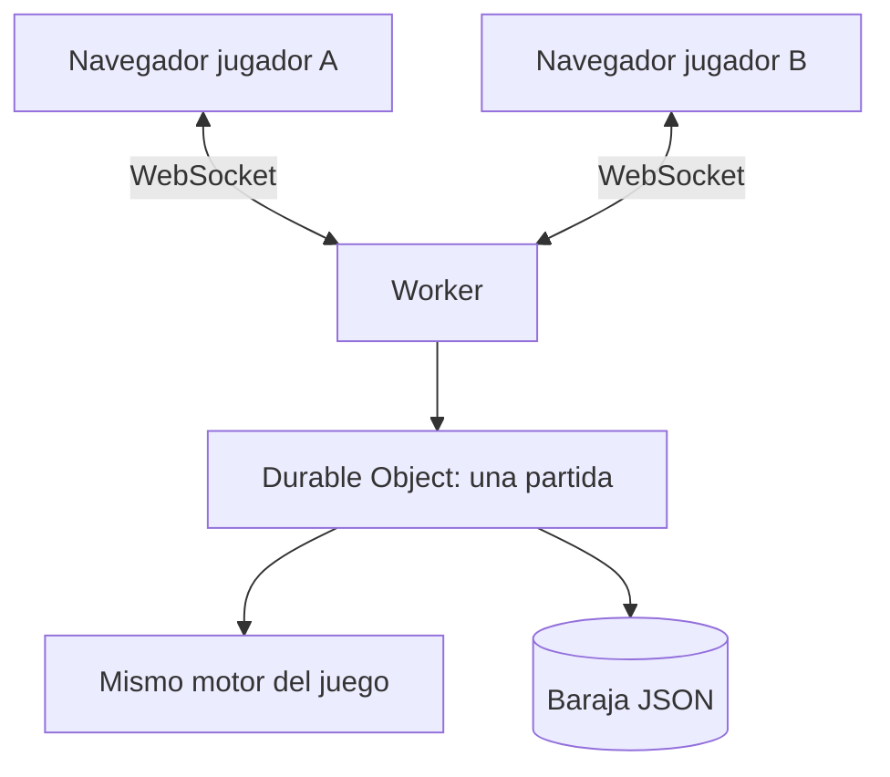

# Arquitectura técnica

<!-- Documento vivo. Actualizar cada vez que cambie el stack, la estructura de carpetas
     o cualquier decisión técnica relevante.
     Los cambios deben registrarse también en changelog/. -->

---

## Stack seleccionado

| Capa | Tecnología | Justificación |
|------|-----------|---------------|
| Lenguaje | TypeScript (estricto) | El motor del juego se comparte entre navegador y servidor (nivel 2); los tipos evitan que se desincronicen. |
| Framework UI | React + Vite | SPA estática, sin necesidad de SSR. Vite da arranque instantáneo en local y genera archivos estáticos que Cloudflare sirve tal cual. |
| Motor del juego | TypeScript puro, sin dependencias de DOM ni React | Reglas, turnos, filtrado de fichas y la máquina. Se prueba con tests unitarios y se reutiliza en el servidor del nivel 2. |
| Estilos y 3D | CSS con variables (CSS Modules) | Las transformaciones 3D (perspectiva, bisagra, cascada) son más legibles en CSS propio que en clases de utilidad. Los tokens de `design-system.md` viven como variables CSS. |
| Validación de datos | Zod | Valida el esquema de cada baraja al compilar y en el script de equilibrio. |
| Fuentes | Fontsource (autoalojadas) | Sin peticiones a Google Fonts en tiempo de ejecución. |
| Procesado de fotos | `pnpm procesar-fotos` (Node + `sharp`) con `rembg` y OpenCV en Python | Descarga de Commons, fondo quitado con `rembg` (MIT), recorte 3:4 con los ojos en el mismo punto, fondo uniforme y WebP a 600×800 y 300×400. Se ejecuta en local, nunca en el navegador ni en el despliegue. |
| Base de datos | Ninguna (niveles 1 y 2) | La baraja es un JSON versionado en el repo. El estado de partida vive en el navegador (nivel 1) o en el Durable Object (nivel 2). |
| Autenticación | Ninguna | El juego no tiene cuentas (PRD, WON'T). |
| Tiempo real (nivel 2) | Cloudflare Durable Objects + WebSockets | Un objeto por partida guarda los dos personajes secretos y arbitra los turnos. Así nadie puede ver el secreto del rival en el código del navegador. |
| Despliegue | Cloudflare Workers con assets estáticos, conectado al repo de GitHub (Workers Builds) | Cada push a `main` despliega solo. La misma configuración sirve la web estática (nivel 1) y luego añade el Worker y los Durable Objects (nivel 2) sin migrar de servicio. |
| Tests | Vitest + Playwright | Ver `docs/testing.md`. |
| Paquetes | pnpm 11 | Convención del proyecto. |

Las versiones concretas se fijan en `package.json` al instalar (última estable en ese momento).

---

## Diagrama de componentes

Nivel 1 (contra la máquina, todo en el navegador):



Nivel 2 (contra otra persona):



En el nivel 2 el navegador solo recibe lo que puede ver: su propio secreto, las respuestas y el
número de fichas levantadas del rival.

---

## Estructura de carpetas

Existe ya todo lo del nivel 1; `worker/` es del nivel 2 y todavía no existe.

```
src/
├── engine/           → Motor del juego: estado, turnos, preguntas, filtrado, la máquina (sin DOM)
│   ├── game.ts       → Crear partida, preguntar, adivinar, bajar/levantar fichas, vista por jugador
│   ├── bot.ts        → La máquina
│   ├── random.ts     → Azar con semilla
│   └── test-deck.ts  → Baraja pequeña para los tests
├── decks/
│   ├── schema.ts     → Esquema Zod de una baraja
│   └── politicos-es/ → Baraja: deck.json (personajes, atributos, preguntas, colores) y fotos procesadas
├── ui/
│   ├── game/         → useGame: conecta la interfaz con el motor (solo lee playerView)
│   ├── board/        → Tablero 3D y fichas
│   ├── hud/          → Contador del rival, carta secreta, lista de preguntas, respuestas
│   └── screens/      → Inicio, partida, fin de partida, créditos
├── styles/           → Tokens del design system como variables CSS y estilos globales
└── main.tsx          → Entrada de la app
worker/               → (nivel 2) Worker y Durable Object de partidas
scripts/
├── procesar-fotos.ts → Descarga, quita el fondo, recorta y exporta las fotos de cada baraja
├── quitar-fondo.py   → Fondo con rembg (lo llama procesar-fotos)
├── detectar-ojos.py  → Propone `photo.crop` detectando cara y ojos con OpenCV
├── validar-baraja.ts → Comprueba esquema y equilibrio (M-10)
└── verificar-cobertura.mjs
fotos-originales/     → Originales descargados y recortes sin fondo (no se suben al repo)
public/fotos/<baraja>/ → Fotos procesadas en 600/ y 300/ (sí se suben)
.venv-fotos/          → Entorno de Python con rembg y OpenCV (no se sube)
tests/
└── e2e/              → Tests de Playwright
```

---

## Estrategia de autenticación

No hay autenticación. En el nivel 2, cada jugador se identifica dentro de una partida con un
identificador aleatorio que genera el servidor al unirse y guarda el navegador en
`sessionStorage` para poder reconectar.

---

## Integraciones externas

- **Wikimedia Commons (y otras fuentes oficiales con licencia compatible):** origen de las fotos.
  No es una integración en tiempo de ejecución: las fotos se descargan una vez, se procesan en
  local y se versionan con su autor, licencia y URL de origen en `deck.json`.
- **Cloudflare:** hosting (nivel 1) y Workers + Durable Objects (nivel 2).

---

## MCPs del proyecto

No se añade ningún MCP al proyecto (decisión del 2026-10-16):

- **Cloudflare:** el usuario ya lo tiene conectado a nivel de cuenta (alcance `user`), así que no
  hace falta declararlo en `.mcp.json`.
- **Playwright:** no hace falta MCP. Playwright entra como dependencia de desarrollo del proyecto
  para los E2E, y para revisar el juego en local el agente usa el navegador integrado de la app.

<!-- Recordatorio: las claves reales nunca van en .mcp.json. Se referencian como ${VARIABLE}
     y el valor vive en .env.local o en el entorno del shell. -->

---

## Estrategia de despliegue

- **Local:** `pnpm dev` (Vite) para desarrollar; `pnpm build && pnpm preview` para probar el
  resultado final. En el nivel 2, `wrangler dev` levanta el Worker y los Durable Objects en local.
- **Producción:** Cloudflare Workers con assets estáticos, configurado en `wrangler.jsonc` y
  conectado al repositorio de GitHub desde el panel de Cloudflare (Workers Builds). Cada push a
  `main` construye (`pnpm build`) y publica; las ramas y PR generan versiones de vista previa.
- **Quién despliega:** el usuario: sube el repo a GitHub y conecta el repositorio en el panel de
  Cloudflare una vez. A partir de ahí, publicar es mergear a `main`, y eso también lo hace el
  usuario. El agente prepara `wrangler.jsonc` y los scripts, pero no conecta ni publica.
- **Variables de entorno:** ninguna en el nivel 1.

---

## Decisiones técnicas relevantes

### 2026-10-16 — Motor del juego separado de la interfaz
**Contexto:** el nivel 2 necesita que el servidor arbitre la partida con las mismas reglas.
**Opciones consideradas:** lógica dentro de los componentes React; motor independiente.
**Decisión:** motor en TypeScript puro en `src/engine/`, sin imports de React ni del DOM.
**Consecuencias:** el nivel 2 importa el mismo motor desde el Durable Object; las reglas se
prueban con tests unitarios rápidos.

### 2026-10-16 — 3D con CSS, no WebGL
**Contexto:** el tablero se ve a 45°, gira un poco en escritorio y las fichas caen con bisagra.
**Opciones consideradas:** Three.js / React Three Fiber; transformaciones 3D de CSS.
**Decisión:** CSS 3D. Son 24 planos con fotos y una cámara casi fija; no hace falta motor 3D.
**Consecuencias:** menos peso y mejor accesibilidad (las fichas siguen siendo botones del DOM).
Si en el prototipo la sensación de plástico se queda corta, se revisa.

### 2026-10-16 — Baraja como datos, no como código
**Contexto:** habrá barajas de otros temas.
**Decisión:** cada baraja es una carpeta con `deck.json` (personajes, atributos, preguntas, colores de tablero y créditos) y sus fotos. El motor no sabe nada de política.
**Consecuencias:** añadir una baraja no toca el código; el script de validación se aplica a todas.

### 2026-10-18 — Herramientas para las fotos
**Contexto:** quitar el fondo y encuadrar 24 fotos de origen distinto de forma repetible.
**Opciones consideradas:** `@imgly/background-removal` (AGPL), `rembg` (MIT), recorte a mano.
**Decisión:** `rembg` con el modelo `isnet-general-use`, quedándose solo con la silueta principal, y
OpenCV 4 (clasificadores Haar) para proponer el punto de los ojos. Ambos en `.venv-fotos/` (Python
3.14, creado con `uv`). Python se lanza con `-I` porque la carpeta `coverage/` de Vitest tapa un
paquete de Python con el mismo nombre.
**Consecuencias:** para regenerar fotos hace falta ese entorno; para jugar o desplegar, no: las fotos
procesadas están en el repo.

### 2026-10-16 — Recorte de fotos con coordenadas guardadas
**Contexto:** las fotos tienen que tener el mismo encuadre.
**Decisión:** cada personaje guarda en `deck.json` el punto de los ojos y la escala; el script de
procesado recorta a partir de esos datos. La herramienta para quitar el fondo se elige al
construir esa feature, comprobando antes su licencia.
**Consecuencias:** el resultado se puede reproducir y ajustar sin volver a editar las fotos a mano.
