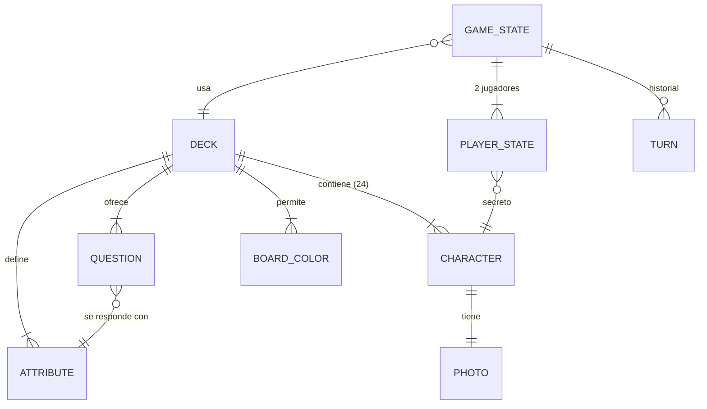

# Modelo de datos

<!-- Actualizar este archivo cada vez que se añada, modifique o elimine una entidad o relación.
     El agente de codificación debe consultar este archivo antes de cambiar el esquema de una
     baraja o el estado de partida. -->

No hay base de datos. Hay dos tipos de datos:

1. **La baraja** (`src/decks/<id>/deck.json`): datos estáticos y versionados en el repo, validados
   con Zod al compilar y con `pnpm validar-baraja`.
2. **El estado de partida**: vive en memoria en el navegador (nivel 1) o en el almacenamiento del
   Durable Object de cada partida (nivel 2). No se guarda nada entre partidas.

---

## Entidades principales

### Deck (baraja)

| Campo | Tipo | Descripción |
|-------|------|-------------|
| id | string (kebab-case, único) | `politicos-es` |
| name | string | Nombre visible: "Políticos de España" |
| version | string (semver) | Sube cuando cambian personajes o atributos |
| dataAsOf | string (fecha ISO) | Fecha a la que corresponden cargos y datos |
| boardColors | BoardColor[] | Colores de tablero elegibles (C-05) |
| defaultColors | { player: string, rival: string } | IDs de `boardColors` por defecto (rojo / azul) |
| attributes | Attribute[] | Rasgos sí/no que puede tener un personaje |
| questions | Question[] | Preguntas de la lista cerrada |
| characters | Character[] | Exactamente 24 |

### BoardColor

| Campo | Tipo | Descripción |
|-------|------|-------------|
| id | string | `psoe`, `pp`, `vox`… |
| label | string | "Rojo", "Azul"… (lo que ve el jugador) |
| base | string (hex) | Color del plástico |
| shade | string (hex) | Color en sombra |

### Attribute

| Campo | Tipo | Descripción |
|-------|------|-------------|
| id | string | `mujer`, `izquierda`, `gafas`… |
| kind | `"identidad"` \| `"trayectoria"` \| `"ideologia"` | Identidad: sexo y bloque. Trayectoria: dato biográfico comprobable. Ideología: postura del programa de su partido |
| source | string | De dónde sale el dato (ficha del Congreso, Wikipedia, programa electoral…) |

No hay atributos físicos (gafas, barba, pelo…): el sexo es el único rasgo personal que se
pregunta.

Todos los atributos son booleanos. Un dato con más valores (partido, año de nacimiento) se
convierte en una o varias preguntas sí/no ("¿Es del PP?", "¿Nació antes de 1970?").

### Question

| Campo | Tipo | Descripción |
|-------|------|-------------|
| id | string | `q-mujer`, `q-gafas`… |
| attributeId | string (→ Attribute) | Atributo que responde la pregunta |
| text.neutral | string | "¿Es mujer?" |
| text.humor | string | Misma pregunta en tono humor (M-12) |

La respuesta a una pregunta es siempre `character.attributes[attributeId]`. El tono solo cambia
`text`, nunca el atributo.

### Character

| Campo | Tipo | Descripción |
|-------|------|-------------|
| id | string (kebab-case, único en la baraja) | `pedro-sanchez` |
| name | string | Nombre en la placa: "PEDRO" o "SÁNCHEZ" (se decide al ver cómo cabe) |
| fullName | string | "Pedro Sánchez Pérez-Castejón" |
| role | string | Cargo a fecha `dataAsOf`, o el último relevante si ya no está en activo |
| attributes | Record<attributeId, boolean> | Un valor por cada atributo de la baraja, sin huecos |
| photo | Photo | Foto y crédito |

### Photo

| Campo | Tipo | Descripción |
|-------|------|-------------|
| file | string | Nombre de la foto procesada: `pedro-sanchez.webp` |
| original | string | Archivo original en `fotos-originales/` (no se publica) |
| author | string | Autor según la fuente |
| license | string | `CC BY 4.0`, `CC BY-SA 3.0`, `Dominio público`… |
| licenseUrl | string (URL) | Texto de la licencia |
| sourceUrl | string (URL) | Página de la foto en la fuente (Commons, Congreso…) |
| crop | { eyeX: number, eyeY: number, scale: number } | Punto medio entre los ojos (0–1) y escala, para el recorte uniforme |

### GameState (en memoria / Durable Object)

| Campo | Tipo | Descripción |
|-------|------|-------------|
| seed | number | Semilla del azar; con la misma semilla, el mismo reparto (tests) |
| deckId | string | Baraja de la partida |
| tone | `"neutral"` \| `"humor"` | Elegido al empezar (M-12) |
| difficulty | `"facil"` \| `"dificil"` | Nivel de la máquina (S-01) |
| phase | `"jugando"` \| `"terminada"` | |
| turn | PlayerId | A quién le toca |
| players | Record<PlayerId, PlayerState> | Dos jugadores: `jugador` y `rival` (máquina u otra persona) |
| history | Turn[] | Preguntas y respuestas en orden (S-03) |
| winner | PlayerId \| null | Al terminar |

### PlayerState

| Campo | Tipo | Descripción |
|-------|------|-------------|
| secretId | string (→ Character) | Personaje secreto. En el nivel 2 nunca se envía al otro jugador |
| upIds | string[] | Fichas levantadas en su tablero |
| color | string (→ BoardColor) | Color de su tablero |

### Turn

| Campo | Tipo | Descripción |
|-------|------|-------------|
| by | PlayerId | Quién pregunta o adivina |
| type | `"pregunta"` \| `"adivinar"` | |
| questionId / guessId | string | Pregunta hecha o personaje propuesto |
| answer | boolean | Respuesta (o si ha acertado) |

---

## Relaciones entre entidades

---

## Reglas de validación (`pnpm validar-baraja`, M-10)

- 24 personajes, ids únicos, todos con valor para todos los atributos.
- Cada pregunta: entre 8 y 16 personajes responden "sí".
- `mujer` e `izquierda`: entre 10 y 14 personajes responden "sí".
- No hay dos personajes con exactamente los mismos atributos (si no, sería imposible
  distinguirlos).
- Toda foto tiene `author`, `license`, `licenseUrl` y `sourceUrl`, y la licencia está en la lista
  de admitidas.
- Toda pregunta tiene texto en los dos tonos.

---

## Datos seed: baraja `politicos-es` (propuesta, pendiente de revisar)

### Personajes propuestos (24)

Equilibrio: 12 mujeres y 12 hombres; 12 de izquierda y 12 de derecha, con 6 y 6 de cada sexo en
cada bloque. Mezcla de cargos en activo y figuras ya retiradas, para que "¿Sigue en activo?" sea
una buena pregunta.

La clasificación izquierda/derecha sigue la posición habitual del partido en el eje
izquierda-derecha. Junts y Cs se cuentan en la derecha (centroderecha).

| Bloque | Mujeres | Hombres |
|--------|---------|---------|
| Izquierda | Yolanda Díaz (Sumar), María Jesús Montero (PSOE), Ione Belarra (Podemos), Irene Montero (Podemos), Mónica García (Más Madrid), Ana Pontón (BNG) | Pedro Sánchez (PSOE), Salvador Illa (PSC), Óscar Puente (PSOE), Gabriel Rufián (ERC), Pablo Iglesias (Podemos), Alberto Garzón (IU) |
| Derecha | Isabel Díaz Ayuso (PP), Cuca Gamarra (PP), Esperanza Aguirre (PP), Inés Arrimadas (Cs), Rocío Monasterio (ex-Vox), Míriam Nogueras (Junts) | Alberto Núñez Feijóo (PP), Juanma Moreno (PP), Mariano Rajoy (PP), Santiago Abascal (Vox), Albert Rivera (Cs), Carles Puigdemont (Junts) |

Suplentes si falta foto con licencia válida: Ada Colau, Pilar Alegría, Félix Bolaños, Arnaldo
Otegi, Ignacio Garriga, Pepa Millán, Aitor Esteban.

### Reglas para las preguntas

1. **Nada físico** salvo el sexo.
2. **Respuesta inequívoca.** Si una persona razonable podría contestar distinto, la pregunta no
   entra: una respuesta discutible hace que el jugador baje fichas que no debía y la partida se
   rompe.
3. **Con fuente.** Cada valor de cada personaje se puede comprobar.
4. **La ideología, a nivel de partido.** Se pregunta por lo que defiende el programa de su
   partido, no por lo que opina la persona.
5. **Que no repita "izquierda".** Una pregunta ideológica que contestan "sí" todos los de un bloque
   no aporta nada después de preguntar "¿Es de izquierdas?". Solo valen las que cruzan bloques o
   parten un bloque por dentro.

### Atributos y preguntas candidatas

Los recuentos son estimaciones con la lista de arriba; se comprueban con fuente al construir la
baraja y el validador decide cuáles entran.

| Atributo | Tipo | Pregunta (neutral) | "Sí" aprox. |
|----------|------|--------------------|:-----------:|
| mujer | identidad | ¿Es mujer? | 12 |
| izquierda | identidad | ¿Es de izquierdas? | 12 |
| consejo-ministros | trayectoria | ¿Ha formado parte del Consejo de Ministros? | 11 |
| gobierno-territorial | trayectoria | ¿Ha presidido una comunidad autónoma o un ayuntamiento? | 8 |
| candidato-presidente | trayectoria | ¿Ha sido candidato a la presidencia del Gobierno? | 8 |
| lider-partido | trayectoria | ¿Ha sido el máximo líder de su partido? | ~12 |
| en-activo | trayectoria | ¿Tiene hoy un cargo público o en su partido? | ~16 |
| nacido-antes-1975 | trayectoria | ¿Nació antes de 1975? | ~12 |
| eurodiputado | trayectoria | ¿Ha sido eurodiputado? | a contar |
| partido-nuevo | trayectoria | ¿Su partido se fundó después de 2010? | ~9 |
| republica | ideologia | ¿Su partido defiende que España (o su territorio) sea una república? | ~10 |
| apoyo-investidura-sanchez | ideologia | ¿Su partido ha apoyado una investidura de Pedro Sánchez? | ~12 |

`republica` y `apoyo-investidura-sanchez` son ejemplos de lo que buscamos: cruzan los bloques (Junts es de
derecha y republicano; el PSOE es de izquierda y no lo es) y tienen respuesta comprobable.

Descartadas: inmigración, impuestos, aborto y similares, porque repiten casi exactamente el eje
izquierda-derecha y porque resumirlas en un sí/no por persona es discutible.
