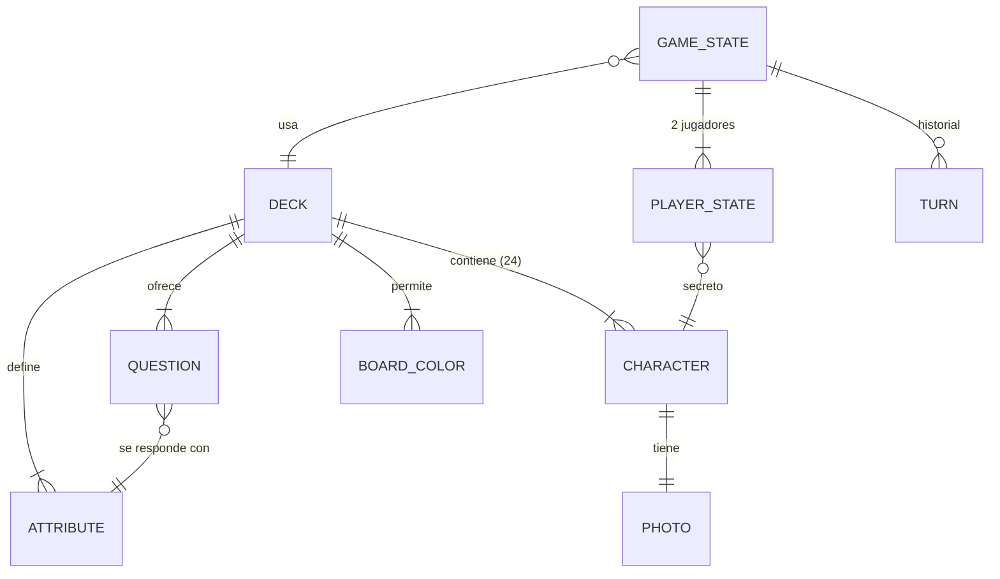

# Modelo de datos

<!-- Actualizar este archivo cada vez que se añada, modifique o elimine una entidad o relación.
     El agente de codificación debe consultar este archivo antes de cambiar el esquema de una
     baraja o el estado de partida. -->

No hay base de datos. Hay dos tipos de datos:

1. **La baraja** (`src/decks/<id>/deck.json`): datos estáticos y versionados en el repo, validados
   con Zod al compilar y con `pnpm validar-baraja`.
2. **El estado de partida**: vive en memoria en el navegador (nivel 1) o en el almacenamiento del
   Durable Object de cada partida (nivel 2). No se guarda nada entre partidas.

---

## Entidades principales

### Deck (baraja)

| Campo | Tipo | Descripción |
|-------|------|-------------|
| id | string (kebab-case, único) | `politicos-es` |
| name | string | Nombre visible: "Políticos de España" |
| version | string (semver) | Sube cuando cambian personajes o atributos |
| dataAsOf | string (fecha ISO) | Fecha a la que corresponden cargos y datos |
| boardColors | BoardColor[] | Colores de tablero elegibles (C-05) |
| defaultColors | { player: string, rival: string } | IDs de `boardColors` por defecto (rojo / azul) |
| attributes | Attribute[] | Rasgos sí/no que puede tener un personaje |
| questions | Question[] | Preguntas de la lista cerrada |
| characters | Character[] | Exactamente 24 |

### BoardColor

| Campo | Tipo | Descripción |
|-------|------|-------------|
| id | string | `psoe`, `pp`, `vox`… |
| label | string | "Rojo", "Azul"… (lo que ve el jugador) |
| base | string (hex) | Color del plástico |
| shade | string (hex) | Color en sombra |

### Attribute

| Campo | Tipo | Descripción |
|-------|------|-------------|
| id | string | `mujer`, `izquierda`, `gafas`… |
| kind | `"identidad"` \| `"trayectoria"` \| `"ideologia"` | Identidad: sexo y bloque. Trayectoria: dato biográfico comprobable. Ideología: postura del programa de su partido |
| source | string | De dónde sale el dato (ficha del Congreso, Wikipedia, programa electoral…) |
| core | boolean? | Reparto principal de la baraja (sexo, bloque): el validador lo exige entre 10 y 14 |

No hay atributos físicos (gafas, barba, pelo…): el sexo es el único rasgo personal que se
pregunta.

Todos los atributos son booleanos. Un dato con más valores (partido, año de nacimiento) se
convierte en una o varias preguntas sí/no ("¿Es del PP?", "¿Nació antes de 1970?").

### Question

| Campo | Tipo | Descripción |
|-------|------|-------------|
| id | string | `q-mujer`, `q-gafas`… |
| attributeId | string (→ Attribute) | Atributo que responde la pregunta |
| text | string | "¿Es mujer?". Tono neutral y una sola pregunta, sin alternativas con "o" |

La respuesta a una pregunta es siempre `character.attributes[attributeId]`.

### Character

| Campo | Tipo | Descripción |
|-------|------|-------------|
| id | string (kebab-case, único en la baraja) | `pedro-sanchez` |
| name | string | Nombre en la placa: "PEDRO" o "SÁNCHEZ" (se decide al ver cómo cabe) |
| fullName | string | "Pedro Sánchez Pérez-Castejón" |
| role | string | Cargo a fecha `dataAsOf`, o el último relevante si ya no está en activo |
| attributes | Record<attributeId, boolean> | Un valor por cada atributo de la baraja, sin huecos |
| sources | string[] (URL, mínimo 2) | Fuentes con las que se ha contrastado cada dato del personaje |
| photo | Photo | Foto y crédito (M-11) |

### Photo

| Campo | Tipo | Descripción |
|-------|------|-------------|
| file | string | Nombre de la foto procesada: `pedro-sanchez.webp`. Se sirve en `public/fotos/<baraja>/600/` y `/300/` |
| original | string (URL) | Archivo original en Wikimedia Commons (`upload.wikimedia.org`, sin parámetros). El script lo descarga a `fotos-originales/`, que no se sube al repo |
| author | string | Autor según la fuente |
| license | string | `CC BY 4.0`, `CC BY-SA 3.0`, `Dominio público`… |
| licenseUrl | string (URL) | Texto de la licencia |
| sourceUrl | string (URL) | Página de la foto en la fuente (Commons, Congreso…) |
| crop | { eyeX: number, eyeY: number, scale: number } | Punto medio entre los ojos (fracción del ancho y del alto del original) y alto del recorte como fracción del alto del original. Lo propone `scripts/detectar-ojos.py` y se puede corregir a mano |

### GameState (en memoria / Durable Object)

| Campo | Tipo | Descripción |
|-------|------|-------------|
| seed | number | Semilla del azar; con la misma semilla, el mismo reparto (tests) |
| deckId | string | Baraja de la partida |
| difficulty | `"facil"` \| `"dificil"` | Nivel de la máquina (S-01) |
| phase | `"jugando"` \| `"terminada"` | |
| turn | PlayerId | A quién le toca |
| players | Record<PlayerId, PlayerState> | Dos jugadores: `jugador` y `rival` (máquina u otra persona) |
| history | Turn[] | Preguntas y respuestas en orden (S-03) |
| winner | PlayerId \| null | Al terminar |

### PlayerState

| Campo | Tipo | Descripción |
|-------|------|-------------|
| secretId | string (→ Character) | Personaje secreto. En el nivel 2 nunca se envía al otro jugador |
| upIds | string[] | Fichas levantadas en su tablero |
| color | string (→ BoardColor) | Color de su tablero |

### Turn

| Campo | Tipo | Descripción |
|-------|------|-------------|
| by | PlayerId | Quién pregunta o adivina |
| type | `"pregunta"` \| `"adivinar"` | |
| questionId / guessId | string | Pregunta hecha o personaje propuesto |
| answer | boolean | Respuesta (o si ha acertado) |

---

## Relaciones entre entidades

---

## Reglas de validación (`pnpm validar-baraja`, M-10)

- 24 personajes, ids únicos, todos con valor para todos los atributos y al menos dos fuentes.
- Cada pregunta: entre 8 y 16 personajes responden "sí".
- Atributos `core` (en `politicos-es`, `mujer` e `izquierda`): entre 10 y 14 personajes responden
  "sí".
- No hay dos personajes con exactamente los mismos atributos (si no, sería imposible
  distinguirlos).
- Toda foto tiene `author`, `license`, `licenseUrl` y `sourceUrl`, y la licencia es una de las
  admitidas: CC0, CC BY, CC BY-SA (cualquier versión), dominio público o "Attribution" (plantilla
  de Commons que permite reutilizar citando la fuente; la usan La Moncloa y la Generalitat).
- Con `pnpm validar-baraja`, además, existen los dos tamaños de cada foto procesada.
- Avisos que no fallan: atributos sin pregunta.

---

## Datos seed: baraja `politicos-es`

Vive en `src/decks/politicos-es/deck.json`. Datos a fecha **2026-10-16**, cada uno contrastado con al
menos dos fuentes (las URL de cada personaje están en su campo `sources`).

### Personajes (24)

12 mujeres y 12 hombres; 12 de izquierda y 12 de derecha, con 6 y 6 de cada sexo en cada bloque.
Junts y Cs se cuentan en la derecha (centroderecha). Para las preguntas sobre "su partido", el de
Rocío Monasterio es Vox, el último con el que tuvo cargo.

| Bloque | Mujeres | Hombres |
|--------|---------|---------|
| Izquierda | Yolanda Díaz (Sumar), María Jesús Montero (PSOE), Ada Colau (Comuns), Irene Montero (Podemos), Mónica García (Más Madrid), Ana Pontón (BNG) | Pedro Sánchez (PSOE), Salvador Illa (PSC), Óscar Puente (PSOE), Gabriel Rufián (ERC), Pablo Iglesias (Podemos), Alberto Garzón (IU) |
| Derecha | Isabel Díaz Ayuso (PP), Cuca Gamarra (PP), Esperanza Aguirre (PP), Inés Arrimadas (Cs), Rocío Monasterio (ex-Vox), Míriam Nogueras (Junts) | Alberto Núñez Feijóo (PP), Juanma Moreno (PP), Mariano Rajoy (PP), Santiago Abascal (Vox), Albert Rivera (Cs), Carles Puigdemont (Junts) |

Ione Belarra, de la propuesta inicial, se sustituyó por Ada Colau: con estas preguntas tenía
exactamente las mismas respuestas que Irene Montero y no se podían distinguir.

Suplentes para futuras versiones: Pilar Alegría, Félix Bolaños, Ignacio Garriga, Pepa Millán,
Aitor Esteban, Ione Belarra.

### Reglas para las preguntas

1. **Nada físico** salvo el sexo.
2. **Respuesta inequívoca.** Si una persona razonable podría contestar distinto, la pregunta no
   entra: una respuesta discutible hace que el jugador baje fichas que no debía y la partida se
   rompe.
3. **Con fuente.** Cada valor de cada personaje se puede comprobar en al menos dos fuentes.
4. **La ideología, a nivel de partido.** Se pregunta por lo que hace o defiende su partido, no por
   lo que opina la persona.
5. **Que no repita "izquierda".** Solo valen las que cruzan bloques o parten un bloque por dentro.
6. **Una sola pregunta.** Nada de alternativas unidas con "o" ("¿presidente autonómico o
   alcalde?"): son dos preguntas. Si las dos mitades no pasan el equilibrio por separado, se
   busca otra pregunta.
7. **Nada que dependa del momento exacto** ("¿tiene escaño hoy?"): las Cortes están disueltas por
   las elecciones del 29 de noviembre de 2026 y la respuesta cambia en semanas.

### Preguntas (12)

| Atributo | Pregunta | "Sí" |
|----------|----------|:----:|
| mujer | ¿Es mujer? | 12 |
| izquierda | ¿Es de izquierdas? | 12 |
| consejo-ministros | ¿Ha formado parte del Consejo de Ministros? (incluye presidentes) | 11 |
| parlamento-autonomico | ¿Ha ocupado escaño en un parlamento autonómico? | 15 |
| candidato-presidente | ¿Ha sido el candidato de su partido a presidir el Gobierno en unas generales? | 8 |
| nacido-antes-1975 | ¿Nació antes de 1975? | 14 |
| nacido-anos-70 | ¿Nació en los años setenta? | 12 |
| partido-nuevo | ¿Su partido se fundó después de 2010? | 9 |
| apoyo-investidura-sanchez | ¿Su partido ha votado sí en alguna investidura de Pedro Sánchez? | 16 |
| estudio-derecho | ¿Estudió Derecho? | 9 |
| concejal | ¿Ha sido concejal? (una alcaldía cuenta) | 13 |
| nacio-lengua-cooficial | ¿Nació en una comunidad autónoma con lengua cooficial? | 12 |

Pablo Iglesias cuenta como "no" en `parlamento-autonomico`: ganó el acta en la Asamblea de Madrid
en 2021 y renunció esa misma noche sin ocuparla. Por eso la pregunta dice "ocupado escaño".

Descartadas en esta versión, por no cumplir las reglas: "¿Ha presidido una comunidad autónoma o
ha sido alcalde?" y "¿Es del PSOE (o del PSC) o del PP?" (son dos preguntas; por separado salen
6, 5, 4 y 6), "¿Ha sido el máximo líder de su
partido?" (ambigua con PSC, Sumar o Más Madrid), "¿Tiene hoy un cargo?" (17 "sí" y cambia con las
elecciones), "¿Ha sido eurodiputado?" (solo 3), "¿Su partido defiende la república?" (no hay una
fuente clara para Sumar ni Más Madrid), "¿Ha sido diputado en el Congreso?" (16-17, en el límite
y sin una fuente oficial que confirme los "no").
