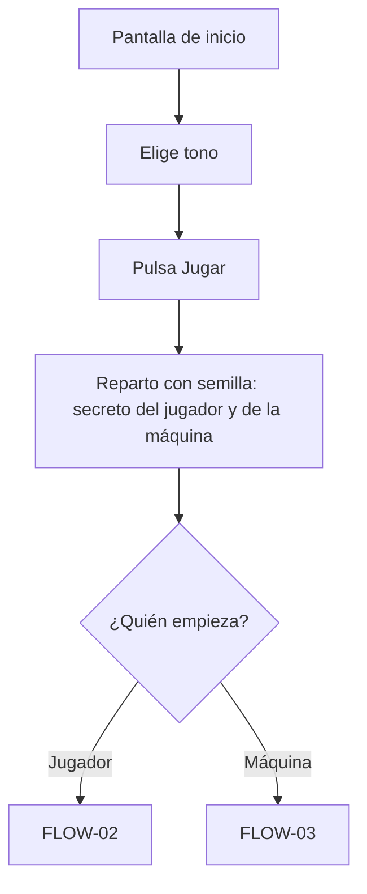
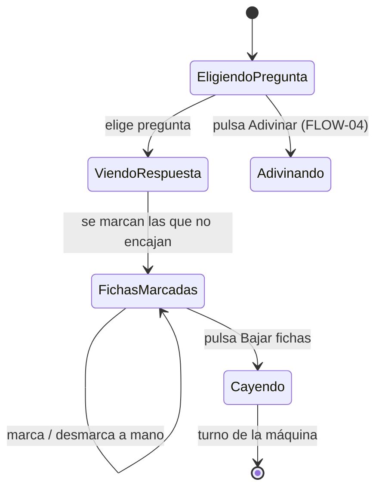
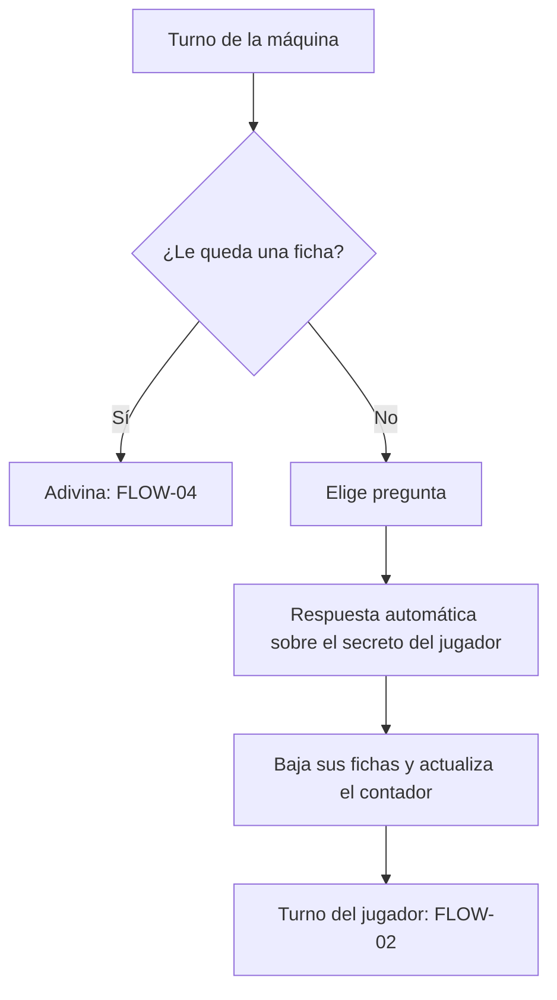
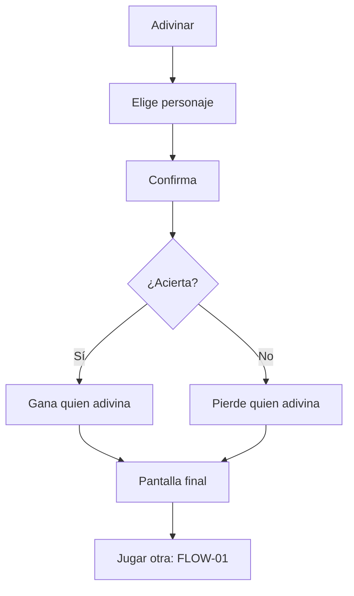

# Flujos de usuario

<!-- Documentación detallada de los flujos de usuario principales.
     El PRD los describe narrativamente; este archivo entra en detalle con diagramas y estados.
     Actualizar cuando cambie un flujo existente o se añada uno nuevo. -->

---

## Convenciones de este documento

Cada flujo tiene un ID (`FLOW-NN`), una descripción paso a paso, un diagrama en Mermaid y sus casos
de error. Los requisitos del PRD se citan por su ID.

Reglas de la partida que aplican a todos los flujos:

- Quién empieza se decide al azar (con la semilla de la partida).
- En cada turno se hace **una** cosa: preguntar o adivinar.
- Las respuestas sobre el personaje del jugador las da el juego; nadie puede mentir.
- Adivinar mal es perder la partida.

---

## [FLOW-01] — Empezar una partida

**Actor:** jugador
**Trigger:** abre la web o pulsa "Jugar otra"
**Resultado esperado:** está en el tablero, con su personaje secreto y el turno asignado

### Pasos

1. Ve la pantalla de inicio: título, elección de tono ("Neutral" / "Con humor") y botón "Jugar".
2. Elige tono (por defecto, el último elegido o "Neutral") — M-12.
3. Pulsa "Jugar".
4. Aparece el tablero con las 24 fichas levantadas — M-01, su carta secreta en la ranura
   delantera — M-02 y, arriba, la ficha del rival con "24" — M-07.
5. Un aviso indica quién empieza.

### Diagrama

### Casos de error

- Fallan las fotos al cargar: la ficha muestra el nombre sobre el fondo uniforme y se puede jugar.
- Si el jugador recarga o cierra la pestaña en mitad de la partida, la partida se pierde (nivel 1
  no guarda estado). El navegador pide confirmación antes de salir.

---

## [FLOW-02] — Turno del jugador: preguntar

**Actor:** jugador
**Trigger:** es su turno
**Resultado esperado:** ha recibido una respuesta y su tablero refleja lo que ha descartado

### Pasos

1. La lista de preguntas se habilita — M-03. Las ya hechas por el jugador aparecen marcadas.
2. Elige una pregunta.
3. Ve la respuesta de la máquina ("Sí" / "No", con texto e icono).
4. Las fichas que no encajan con la respuesta se marcan con contorno amarillo — M-04.
5. Puede desmarcar o marcar fichas antes de confirmar.
6. Pulsa "Bajar fichas": las marcadas caen en cascada.
7. El turno pasa a la máquina.

### Diagrama

### Casos de error

- Ninguna ficha levantada deja de encajar (la pregunta no aporta): se avisa "Esta respuesta no
  descarta a nadie" y el turno pasa igual.
- El jugador intenta preguntar fuera de su turno: la lista está deshabilitada — M-03 (negativo).
- En cualquier momento puede pulsar una ficha para bajarla o levantarla a mano — M-05; no afecta a
  la partida, solo a su tablero.

---

## [FLOW-03] — Turno de la máquina

**Actor:** la máquina
**Trigger:** es su turno
**Resultado esperado:** la máquina ha preguntado o adivinado y el contador del rival está al día

### Pasos

1. Breve pausa ("El rival está pensando…") para que se entienda el cambio de turno.
2. Si a la máquina le queda una sola ficha levantada, adivina (FLOW-04).
3. Si no, elige una pregunta que no haya hecho (al azar en fácil; la que mejor parte sus fichas en
   difícil — S-01).
4. El jugador ve la pregunta y la respuesta sobre su personaje, que da el juego — M-06.
5. La máquina baja sus fichas y la ficha del rival actualiza el número con un volteo — M-07.
6. El turno pasa al jugador.

### Diagrama

### Casos de error

- A la máquina no le quedan preguntas útiles y tiene varias fichas: adivina al azar entre las que
  le quedan.

---

## [FLOW-04] — Adivinar y fin de partida

**Actor:** jugador o máquina
**Trigger:** pulsa "Adivinar" en su turno, o la máquina decide adivinar
**Resultado esperado:** la partida ha terminado y se sabe quién ha ganado

### Pasos

1. El jugador pulsa "Adivinar" y elige una ficha levantada de su tablero — M-08.
2. Confirma ("¿Seguro que es X? Si fallas, pierdes").
3. Si acierta, gana; si falla, pierde.
4. Si adivina la máquina, el jugador ve su propuesta y el resultado.
5. Pantalla final — M-09: quién ha ganado, los dos personajes secretos boca arriba y "Jugar otra"
   (vuelve a FLOW-01).

### Diagrama

### Casos de error

- El jugador cancela en la confirmación: vuelve a su turno sin perderlo.
- Intenta adivinar fuera de su turno: el botón está deshabilitado.
